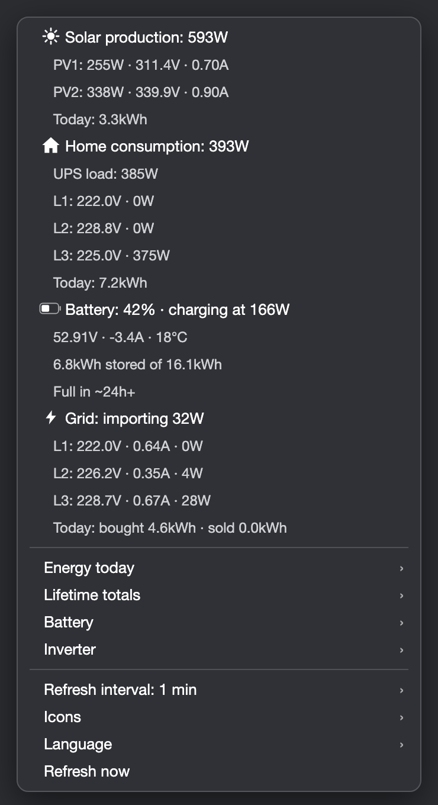

# Deye Menubar


Your Deye hybrid inverter in the macOS menu bar, in the style of MenuMeters. Solar production, battery level and home consumption are always visible, and the full picture is one click away.

<p align="center">
  <br>
  
</p>

## Features

- **Menu bar:** PV production, battery SoC with charge / discharge arrow, home consumption and grid power. Monochrome SF Symbols by default, which stay readable on tinted menu bars and inactive displays; colored symbols or emoji are optional.
- **Grid outage alert:** an icon in the menu bar when the inverter's grid relay opens.
- **Details per PV string and per phase:** power, voltage, current.
- **Battery:** voltage, current, temperature, stored energy, time to full / to reserve, estimated cycles, BMS values.
- **Energy counters:** today and lifetime production, consumption, grid bought / sold, battery charged / discharged, daily grid independence (share of consumption not bought from the grid).
- **Inverter:** output per phase, temperature, grid relay, rated power, firmware.
- **Raw data:** `--dump-device` prints every data point the inverter reports.
- **From the menu:** change the refresh interval (with API quota estimates) and the language.
- **Translations:** English and Romanian included; adding a language is one JSON file.
- **Quota-friendly:** one API call per refresh, token cached, last known data shown if the API is unavailable.
- **Secure:** credentials stored in the macOS Keychain; only the password hash is kept.
- **No dependencies:** Python standard library only, plus [SwiftBar](https://swiftbar.app), which the installer sets up.

> **Disclaimer:** This is an independent project, not affiliated with or endorsed by Deye. It uses the official [Deye Cloud OpenAPI](https://developer.deyecloud.com).

## Requirements

- macOS 12 or newer (tested target: macOS Sequoia).
- Python 3.8+. The macOS Command Line Tools provide this; the installer offers to install them if they are missing.
- A Deye Cloud account with your station already visible in the Deye Cloud app.
- Deye Cloud OpenAPI credentials (`appId` and `appSecret`), described below.

## 1. Get API credentials

1. Go to <https://developer.deyecloud.com> and sign in with your Deye Cloud account.
2. Create an application. You will receive an **appId** and an **appSecret**. Approval can take a little while.
3. Note your region. Europe uses `eu1`; Americas and most other regions use `us1`.

## 2. Install

```bash
git clone https://github.com/bms8197/macos-deye-menubar-widget.git
cd macos-deye-menubar-widget
bash install.sh
```

Alternatively, download the latest zip from [Releases](https://github.com/bms8197/macos-deye-menubar-widget/releases), unzip it and run `bash install.sh` from the extracted folder.

To update later, run `git pull` (or download the new release), then `bash install.sh` again and press Enter to keep your settings.

The installer does the following:

1. Checks for Python 3 and starts the Command Line Tools installer if needed.
2. Installs SwiftBar, using Homebrew if available or the latest GitHub release otherwise.
3. Sets SwiftBar's plugin folder, defaulting to `~/SwiftBar` and keeping your existing folder if you already have one.
4. Asks for region, appId, appSecret, e-mail and password. Secrets go into the **macOS Keychain**, not into a file.
5. Asks for language and refresh interval.
6. Installs the plugin, backing up any previous `deye.*.py` it finds.
7. Tests the login and lets you pick a station if your account has more than one.
8. Optionally adds SwiftBar to Login Items, then starts it.

The installer is safe to re-run at any time to change credentials, station, language or interval. Existing values are offered as defaults, so you can press Enter to keep them.

## 3. Usage

| Indicator | Meaning |
|---|---|
| sun | Current PV production |
| battery | State of charge (the icon fill follows the level); `↑` charging, `↓` discharging |
| house | Current home consumption |
| bolt | Grid power: positive = import, with a minus (e.g. `-93W`) = export |
| yellow text | Battery below the low-battery threshold (default 20%) |
| bolt-slash icon (yellow) | Grid relay open: grid outage, running on battery (replaces the grid value) |
| pause icon | API unavailable or rate-limited; showing the last known data |
| warning icon | Error and no cached data yet; open the menu for details |
| ☀️⚙️ | Not configured; run `install.sh` |

The menu shows the main values with detail lines under each:

- **Solar production**: power, voltage and current for each PV string that is in use, plus today's production.
- **Home consumption**: UPS (backup port) load, plus voltage and power per phase.
- **Battery**: voltage, current, temperature, stored energy, and the estimated time until full (when charging) or until the reserve level (when discharging).
- **Grid**: voltage, current and power per phase, and today's bought / sold energy.
- **Energy today ▸**: production, consumption, bought, sold, charged and discharged, plus today's grid independence.
- **Lifetime totals ▸**: the same counters since installation.
- **Battery ▸**: SoC, voltage, current, power, temperature, BMS values, capacity, energy charged / discharged (today and lifetime), estimated cycles, firmware.
- **Inverter ▸**: output power (total and per phase), temperature, grid relay status, rated power and firmware.

Detail lines only appear for values your inverter actually reports, so a single-phase inverter shows one phase and unused PV strings are hidden.

The menu also contains:

- **Open Deye Cloud** opens the web portal.
- **Show raw JSON** opens the last API response in TextEdit, which is useful for debugging.
- **Refresh interval** changes how often data is fetched (30 s to 15 min), showing the estimated API calls per month for each option, this month's call count on this Mac, and the projection against your quota.
- **Language** switches the UI language instantly. *Automatic* follows the macOS system language and falls back to English.
- **Refresh now** forces an update.

### Refresh interval and rate limits

The interval is part of the file name (`deye.5m.py` = every 5 minutes, the default and the interval of the Deye inverter itself). Change it from the **Refresh interval** menu, or with `--set-interval`.

The Deye Cloud OpenAPI allows **100,000 calls per month** per developer account. Each refresh is one call, so the monthly usage with the Mac awake 24/7 is:

| Interval | Calls / month |
|---|---|
| 30 s | ~86,400 |
| 1 min | ~43,200 |
| 2 min | ~21,600 |
| 5 min | ~8,640 |

The real number is lower, because SwiftBar does not run while the Mac sleeps. Logins happen only when the token expires, about every 60 days. Options that would exceed `monthlyQuota` are shown in red.

By default (`dataSource: "device"`) each refresh makes **one** API request: the inverter's latest data provides both the menu bar values and all the details. The login token is cached for its full lifetime. If the inverter data can't be used, the plugin falls back to the station summary for that refresh. Deye is introducing quotas on the OpenAPI but does not publish exact limits. If you see `⏸` often with a rate-limit message, increase the interval to `10m`.

Also check the *Updated* line in the menu. If the data only changes every 5 minutes, refreshing every minute brings no new information.

## Configuration

Non-secret settings are in `~/.config/deye/config.json`:

```json
{
  "base": "https://eu1-developer.deyecloud.com/v1.0",
  "appId": "…",
  "email": "you@example.com",
  "stationId": 123456,
  "language": "auto",
  "thresholds": { "lowBatteryPercent": 20, "idleWatts": 20, "gridIdleWatts": 0 },
  "invertBatterySign": false,
  "invertGridSign": false,
  "barIcons": "mono",
  "menuIcons": "mono",
  "titleColor": "",
  "lowBatteryColor": "#FFD60A",
  "dataSource": "device",
  "batteryReservePercent": 10,
  "showDetails": true,
  "detailsRefreshSeconds": 120
}
```

| Key | Description |
|---|---|
| `language` | `auto`, or a code from `~/.config/deye/locales/` (`en`, `ro`, …) |
| `thresholds.lowBatteryPercent` | Below this SoC the title turns red |
| `thresholds.idleWatts` | Battery flows below this are shown as idle |
| `thresholds.gridIdleWatts` | Grid flows up to this are shown as ~0. Default `0`: the exact grid power is always shown |
| `invertBatterySign` | Set to `true` if charging and discharging appear reversed on your inverter |
| `invertGridSign` | Set to `true` if import and export appear reversed (Deye convention: positive = import) |
| `barIcons` | Menu bar icons: `mono` (SF Symbols that follow the menu bar color, default), `symbols` (the same SF Symbols, each in its own color, chosen to stay readable on red and blue bars) or `color` (colored emoji). Also selectable from the menu: **Icons ▸ Menu bar** |
| `menuIcons` | Dropdown section icons: `mono` (default), `color` or `none`. Also selectable from the menu: **Icons ▸ Dropdown menu** |
| `titleColor` | Empty = system menu bar color (recommended). Or a fixed color, e.g. `#FFFFFF`; `#FFFFFF,#FFFFFF` sets light and dark mode separately |
| `lowBatteryColor` | Title color when the battery is low; yellow by default so it stays visible on red or dark menu bars |
| `monthlyQuota` | API calls allowed per month (default 100000), used for the projection in the Refresh interval menu |
| `dataSource` | `device` (default, one request with all data) or `station` (station summary, plus inverter details at most every `detailsRefreshSeconds`) |
| `batteryReservePercent` | SoC used for the "down to X% in …" estimate; set it to your inverter's shutdown / reserve SoC |
| `batteryCapacityKWh` | Optional. Battery capacity for the estimates; by default rated Ah × `batteryNominalVoltage` (51.2 V) |
| `showDetails` | Station mode only: `false` disables the inverter details and their extra request |
| `detailsRefreshSeconds` | Station mode only: minimum time between inverter detail requests |
| `titleFont` / `titleSize` | Optional font name (e.g. `SFMono-Regular`) and size for the title |

Changes take effect on the next refresh.

## Adding a translation

English (`en.json`) is the reference and the fallback for every missing key.

1. Copy the reference file:
   ```bash
   cp ~/.config/deye/locales/en.json ~/.config/deye/locales/de.json
   ```
2. Set `"_language_name"` to the language's own name (for example `"Deutsch"`) and translate the values.
3. Keep the `{placeholders}` exactly as they are: `{power}`, `{soc}`, `{state}`, `{time}`, `{minutes}`, `{error}`.

The new language appears in the **Language** menu immediately, and *Automatic* picks it up when it matches the macOS language. Keys you don't translate stay in English.

To ship a translation with the package, also add the file to `locales/` in this folder; the installer copies everything there.

## Files

| Path | Purpose |
|---|---|
| `~/SwiftBar/deye.<interval>.py` | The plugin; the folder may differ if SwiftBar already used another one |
| `~/.config/deye/config.json` | Settings, mode 600 |
| `~/.config/deye/locales/*.json` | Translations |
| `~/.config/deye/token.json` | Cached API token |
| `~/.config/deye/last.json` | Last successful summary, used when the API is unavailable |
| `~/.config/deye/device.json` | Last inverter data (opened by *Show raw JSON*) |
| `~/.config/deye/usage.json` | Local API call counter for the current month |
| `~/.config/deye/backup/` | Previous plugin versions replaced by the installer |
| Keychain, service `deye-menubar` | `appSecret` and the SHA-256 hash of the password |

Only the SHA-256 hash of the password is stored, because that is what the Deye API expects. The plaintext password is never written to disk.

## Command line

```bash
~/SwiftBar/deye.5m.py                     # same output SwiftBar shows
~/SwiftBar/deye.5m.py --check             # test login and list stations (JSON)
~/SwiftBar/deye.5m.py --set-language ro   # change language
~/SwiftBar/deye.5m.py --dump-device       # all inverter data points (key, value, unit)
~/SwiftBar/deye.5m.py --set-interval 2m   # change refresh interval (renames the plugin file)
~/SwiftBar/deye.5m.py --version
```

## Troubleshooting

- **Nothing in the menu bar.** Make sure SwiftBar is running, then use its icon → *Refresh All*. If the menu bar is crowded, macOS hides items that don't fit, so temporarily remove other icons to check.
- **☀️⚙️ Not configured.** Run `bash install.sh` again.
- **Login failed.** Verify appId, appSecret, e-mail and password, and the region (`eu1` vs `us1`). Confirm that the developer application has been approved.
- **Values look wrong or show `–`.** Use *Show raw JSON* to see exactly what Deye returns for your station, then adjust the `invert…Sign` settings if needed.
- **Hard to read on a second display or a tinted menu bar.** macOS dims the menu bar on the inactive display and tints it with the wallpaper. Keep `barIcons: "mono"` and an empty `titleColor`, and consider System Settings → Accessibility → Display → **Reduce transparency**, which gives the menu bar a solid background.
- **Data is old.** The *Updated* line shows how old Deye's data is. If it keeps growing, the inverter's Wi-Fi logger has probably lost its connection to Deye Cloud.

## Uninstall

```bash
bash uninstall.sh
```

The uninstaller removes the plugin and the Keychain items, and optionally the settings folder and SwiftBar itself.

## Tested with

| Inverter | Battery | Notes |
|---|---|---|
| Deye SUN-10K-SG05LP3-EU-SM2 (3-phase hybrid, 10 kW) | Deye LiFePO4 SE-F16 (16 kWh, 51.2 V, 314 Ah, IP21) | Whole house on the UPS (backup) port |

Data point names come from the Deye Cloud API and may differ between inverter models. If something is missing or wrong on yours, open an issue with the output of `--dump-device`. Remove the serial number before posting.

## Contributing

Issues and pull requests are welcome, especially:

- **Translations:** add `locales/<code>.json` (see [Adding a translation](#adding-a-translation)).
- **Other inverter models:** a `--dump-device` output plus a note on what the Deye Cloud app shows for the same moment.

Before opening a pull request, run `bash scripts/check.sh`. It runs the same checks as CI: shell and Python syntax, shellcheck, translation validation, and an end-to-end smoke test against a mock Deye API.

### Releasing

1. Bump `VERSION` in `plugin/deye.py` and add a section to `CHANGELOG.md`.
2. Commit and push to `main`. CI runs on Linux (Python 3.9 and 3.13) and macOS.
3. Tag and push: `git tag v1.5.0 && git push --tags`.

The release workflow checks that the tag matches `VERSION`, builds `deye-menubar-<version>.zip` (without tests, CI files and docs), and publishes a GitHub release with the changelog section as notes.

## License

[MIT](LICENSE)
