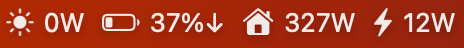
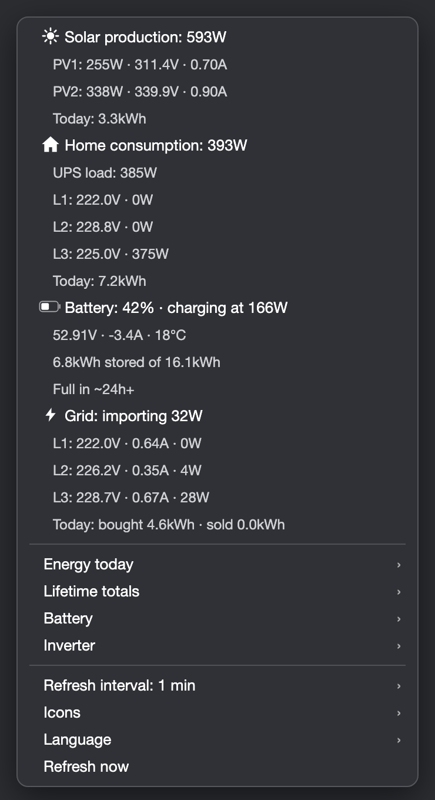

# Deye Menubar

[English](README.md) | **Română**


Invertorul tău hibrid Deye în bara de meniu macOS, în stilul MenuMeters. Producția solară, nivelul bateriei și consumul casei sunt mereu vizibile, iar imaginea completă e la un click distanță.

<p align="center">
  <br>
  
</p>

## Funcționalități

- **Bara de meniu:** producția PV, nivelul bateriei (SoC) cu săgeată de încărcare / descărcare, consumul casei și puterea din rețea. Implicit, simboluri SF Symbols monocrome, care rămân lizibile pe bare de meniu colorate și pe ecranele inactive; simbolurile colorate sau emoji sunt opționale.
- **Alertă de cădere a rețelei:** o iconiță în bara de meniu când releul de rețea al invertorului se deschide.
- **Detalii pe string PV și pe fază:** putere, tensiune, curent.
- **Baterie:** tensiune, curent, temperatură, energie stocată, timp până la plin / până la rezervă, cicluri estimate, valori BMS.
- **Contoare de energie:** producție și consum azi și totale, energie cumpărată / vândută în rețea, încărcată / descărcată din baterie, independența zilnică față de rețea (partea din consum care nu a fost cumpărată din rețea).
- **Invertor:** ieșire pe fază, temperatură, releu de rețea, putere nominală, firmware.
- **Date brute:** `--dump-device` afișează toate punctele de date raportate de invertor.
- **Din meniu:** schimbi intervalul de actualizare (cu estimări ale cotei API) și limba.
- **Traduceri:** engleza și româna sunt incluse; o limbă nouă înseamnă un singur fișier JSON.
- **Economic cu cota:** un apel API la fiecare actualizare, token păstrat în cache, ultimele date cunoscute rămân afișate dacă API-ul nu răspunde.
- **Sigur:** datele de autentificare sunt în Keychain-ul macOS; se păstrează doar hash-ul parolei.
- **Fără dependențe:** doar biblioteca standard Python, plus [SwiftBar](https://swiftbar.app), pe care îl instalează installer-ul.

> **Declinare de responsabilitate:** Acesta este un proiect independent, fără legătură cu Deye și neaprobat de aceasta. Folosește [Deye Cloud OpenAPI](https://developer.deyecloud.com) oficial.

## Cerințe

- macOS 12 sau mai nou (ținta testată: macOS Sequoia).
- Python 3.8+. Îl oferă macOS Command Line Tools; installer-ul se oferă să le instaleze dacă lipsesc.
- Un cont Deye Cloud cu stația ta deja vizibilă în aplicația Deye Cloud.
- Datele de acces la Deye Cloud OpenAPI (`appId` și `appSecret`), descrise mai jos.

## 1. Obține datele de acces la API

1. Mergi la <https://developer.deyecloud.com> și autentifică-te cu contul tău Deye Cloud.
2. Creează o aplicație. Vei primi un **appId** și un **appSecret**. Aprobarea poate dura puțin.
3. Notează regiunea. Europa folosește `eu1`; America și majoritatea celorlalte regiuni folosesc `us1`.

## 2. Instalare

```bash
git clone https://github.com/bms8197/macos-deye-menubar-widget.git
cd macos-deye-menubar-widget
bash install.sh
```

Alternativ, descarcă ultimul zip din [Releases](https://github.com/bms8197/macos-deye-menubar-widget/releases), dezarhivează-l și rulează `bash install.sh` din folderul extras.

Pentru actualizări ulterioare, rulează `git pull` (sau descarcă noul release), apoi din nou `bash install.sh` și apasă Enter ca să păstrezi setările.

Installer-ul face următoarele:

1. Verifică Python 3 și pornește instalarea Command Line Tools dacă e nevoie.
2. Instalează SwiftBar, prin Homebrew dacă există, altfel din ultimul release de pe GitHub.
3. Setează folderul de pluginuri SwiftBar, implicit `~/SwiftBar`, păstrându-l pe cel existent dacă ai deja unul.
4. Îți cere regiunea, appId, appSecret, e-mailul și parola. Secretele ajung în **Keychain-ul macOS**, nu într-un fișier.
5. Îți cere limba și intervalul de actualizare.
6. Instalează pluginul, făcând backup oricărui `deye.*.py` anterior găsit.
7. Testează autentificarea și te lasă să alegi o stație dacă ai mai multe în cont.
8. Opțional adaugă SwiftBar la Login Items, apoi îl pornește.

Installer-ul poate fi rulat din nou oricând pentru a schimba datele de acces, stația, limba sau intervalul. Valorile existente sunt oferite ca implicite, deci poți apăsa Enter ca să le păstrezi.

## 3. Utilizare

| Indicator | Semnificație |
|---|---|
| soare | Producția PV curentă |
| baterie | Nivelul de încărcare (umplerea iconiței urmează nivelul); `↑` se încarcă, `↓` se descarcă |
| casă | Consumul curent al casei |
| fulger | Puterea din rețea: pozitiv = import, cu minus (de ex. `-93W`) = export |
| text galben | Bateria sub pragul de baterie slabă (implicit 20%) |
| fulger tăiat (galben) | Releu de rețea deschis: cădere de rețea, funcționare pe baterie (înlocuiește valoarea din rețea) |
| iconiță pauză | API indisponibil sau limitat; se afișează ultimele date cunoscute |
| iconiță avertisment | Eroare și încă nu există date în cache; deschide meniul pentru detalii |
| ☀️⚙️ | Neconfigurat; rulează `install.sh` |

Meniul arată valorile principale, cu linii de detaliu sub fiecare:

- **Producție PV**: putere, tensiune și curent pentru fiecare string PV folosit, plus producția de azi.
- **Consum casă**: consumul UPS (portul de backup), plus tensiune și putere pe fază.
- **Baterie**: tensiune, curent, temperatură, energie stocată și timpul estimat până la plin (la încărcare) sau până la nivelul de rezervă (la descărcare).
- **Rețea**: tensiune, curent și putere pe fază, plus energia cumpărată / vândută azi.
- **Energie azi ▸**: producție, consum, cumpărat, vândut, încărcat și descărcat, plus independența de azi față de rețea.
- **Totaluri ▸**: aceleași contoare de la instalare.
- **Baterie ▸**: SoC, tensiune, curent, putere, temperatură, valori BMS, capacitate, energie încărcată / descărcată (azi și total), cicluri estimate, firmware.
- **Invertor ▸**: putere de ieșire (totală și pe fază), temperatură, starea releului de rețea, putere nominală și firmware.

Liniile de detaliu apar doar pentru valorile pe care invertorul tău le raportează, deci un invertor monofazat arată o singură fază, iar stringurile PV nefolosite sunt ascunse.

Meniul mai conține:

- **Deschide Deye Cloud** deschide portalul web.
- **Arată JSON brut** deschide ultimul răspuns al API-ului în TextEdit, util pentru depanare.
- **Interval actualizare** schimbă cât de des se aduc datele (de la 30 s la 15 min), arătând pentru fiecare opțiune apelurile API estimate pe lună, numărul de apeluri din luna curentă pe acest Mac și proiecția față de cota ta.
- **Limbă** schimbă limba interfeței instantaneu. *Automat* urmează limba sistemului macOS și revine la engleză dacă nu o găsește.
- **Actualizează acum** forțează o actualizare.

### Intervalul de actualizare și limitele de apeluri

Intervalul face parte din numele fișierului (`deye.5m.py` = la fiecare 5 minute, valoarea implicită și intervalul cu care raportează invertorul Deye). Îl schimbi din meniul **Interval actualizare** sau cu `--set-interval`.

Deye Cloud OpenAPI permite **100.000 de apeluri pe lună** pe cont de dezvoltator. Fiecare actualizare înseamnă un apel, deci consumul lunar cu Mac-ul pornit non-stop este:

| Interval | Apeluri / lună |
|---|---|
| 30 s | ~86.400 |
| 1 min | ~43.200 |
| 2 min | ~21.600 |
| 5 min | ~8.640 |

Numărul real e mai mic, pentru că SwiftBar nu rulează cât Mac-ul doarme. Autentificarea se face doar când expiră tokenul, cam la 60 de zile. Opțiunile care ar depăși `monthlyQuota` sunt afișate cu roșu.

Implicit (`dataSource: "device"`), fiecare actualizare face **o singură** cerere API: ultimele date ale invertorului oferă atât valorile din bara de meniu, cât și toate detaliile. Tokenul de autentificare este păstrat în cache pe toată durata de viață. Dacă datele invertorului nu pot fi folosite, pluginul trece la rezumatul stației pentru acea actualizare. Deye introduce cote pe OpenAPI, dar nu publică limite exacte. Dacă vezi des `⏸` cu un mesaj de limită depășită, mărește intervalul la `10m`.

Verifică și linia *Actualizat* din meniu. Dacă datele se schimbă doar la 5 minute, o actualizare la fiecare minut nu aduce informații noi.

### Program de actualizare (opțional)

Ca să actualizezi des cât ești prin preajmă și rar noaptea, activează **Interval actualizare ▸ Program pe ore ▸ Folosește program orar**. Valorile implicite sunt **1 min între 07:00 și 21:00** și **5 min în rest**; orele intervalului și ambele intervale se schimbă din același submeniu. Funcționează și un interval care trece de miezul nopții (de exemplu 22:00 – 06:00).

- SwiftBar rulează pluginul la cel mai rapid dintre cele două intervale; în afara intervalului orar pluginul sare peste apelul API până trece intervalul mai lent, deci cota numără doar apelurile reale. Cu valorile implicite sunt cam 29.000 de apeluri pe lună, față de 43.200 la 1 min constant.
- Dacă alegi un interval din lista simplă (**30 sec … 15 min**), programul se oprește și acel interval se folosește toată ziua.
- **Actualizează acum** aduce mereu date noi, și în afara intervalului orar.
- Orele urmează ora locală a Mac-ului. Aceleași setări sunt în `config.json`, la cheia `schedule`, iar în linia de comandă există `--set-schedule`.

## Configurare

Setările fără secrete sunt în `~/.config/deye/config.json`:

```json
{
  "base": "https://eu1-developer.deyecloud.com/v1.0",
  "appId": "…",
  "email": "tu@exemplu.com",
  "stationId": 123456,
  "language": "auto",
  "thresholds": { "lowBatteryPercent": 20, "idleWatts": 20, "gridIdleWatts": 0 },
  "invertBatterySign": false,
  "invertGridSign": false,
  "barIcons": "mono",
  "menuIcons": "mono",
  "titleColor": "",
  "lowBatteryColor": "#FFD60A",
  "dataSource": "device",
  "batteryReservePercent": 10,
  "showDetails": true,
  "detailsRefreshSeconds": 120
}
```

| Cheie | Descriere |
|---|---|
| `language` | `auto` sau un cod din `~/.config/deye/locales/` (`en`, `ro`, …) |
| `thresholds.lowBatteryPercent` | Sub acest SoC titlul își schimbă culoarea (`lowBatteryColor`, implicit galben) |
| `thresholds.idleWatts` | Fluxurile bateriei sub această valoare sunt afișate ca standby |
| `thresholds.gridIdleWatts` | Fluxurile din rețea până la această valoare sunt afișate ca ~0. Implicit `0`: puterea exactă din rețea este afișată mereu |
| `invertBatterySign` | Pune `true` dacă încărcarea și descărcarea apar inversate pe invertorul tău |
| `invertGridSign` | Pune `true` dacă importul și exportul apar inversate (convenția Deye: pozitiv = import) |
| `barIcons` | Iconițe în bara de meniu: `mono` (SF Symbols care urmează culoarea barei, implicit), `symbols` (aceleași SF Symbols, fiecare în culoarea ei, alese să rămână lizibile pe bare roșii și albastre) sau `color` (emoji colorate). Se pot alege și din meniu: **Iconițe ▸ Bara de meniu** |
| `menuIcons` | Iconițele secțiunilor din meniul derulant: `mono` (implicit), `color` sau `none`. Se pot alege și din meniu: **Iconițe ▸ Meniul derulant** |
| `titleColor` | Gol = culoarea sistemului pentru bara de meniu (recomandat). Sau o culoare fixă, de ex. `#FFFFFF`; `#FFFFFF,#FFFFFF` setează separat modul luminos și cel întunecat |
| `lowBatteryColor` | Culoarea titlului când bateria e slabă; galben implicit, ca să rămână vizibil pe bare de meniu roșii sau întunecate |
| `monthlyQuota` | Apeluri API permise pe lună (implicit 100000), folosite la proiecția din meniul Interval actualizare |
| `dataSource` | `device` (implicit, o cerere cu toate datele) sau `station` (rezumatul stației, plus detaliile invertorului cel mult la fiecare `detailsRefreshSeconds`) |
| `batteryReservePercent` | SoC folosit pentru estimarea „până la X% în …"; pune nivelul la care se oprește / rezerva invertorului tău |
| `batteryCapacityKWh` | Opțional. Capacitatea bateriei pentru estimări; implicit Ah nominali × `batteryNominalVoltage` (51,2 V) |
| `showDetails` | Doar în modul station: `false` dezactivează detaliile invertorului și cererea suplimentară pentru ele |
| `detailsRefreshSeconds` | Doar în modul station: timpul minim între cererile de detalii ale invertorului |
| `minFetchSeconds` | Opțional (implicit 60, `0` dezactivează). O actualizare manuală sau o schimbare de setare din meniu, la mai puțin de acest timp după ultima aducere de date, afișează datele din cache în loc să apeleze API-ul. Nu se aplică actualizărilor programate |
| `schedule` | Opțional: actualizare după ora din zi, de ex. `{"enabled": true, "from": 7, "to": 21, "inside": "1m", "outside": "5m"}`: `inside` între orele `from` și `to` (0-23, ora locală), `outside` în restul zilei. Dezactivat implicit; vezi *Program de actualizare* |
| `titleFont` / `titleSize` | Opțional: numele fontului (de ex. `SFMono-Regular`) și dimensiunea pentru titlu |

Modificările se aplică la următoarea actualizare.

## Adăugarea unei traduceri

Engleza (`en.json`) este referința și varianta de rezervă pentru orice cheie lipsă.

1. Copiază fișierul de referință:
   ```bash
   cp ~/.config/deye/locales/en.json ~/.config/deye/locales/de.json
   ```
2. Setează `"_language_name"` la numele limbii în limba respectivă (de exemplu `"Deutsch"`) și tradu valorile.
3. Păstrează `{placeholder}`-ele exact cum sunt: `{power}`, `{soc}`, `{state}`, `{time}`, `{minutes}`, `{error}`.

Limba nouă apare imediat în meniul **Limbă**, iar *Automat* o preia când se potrivește cu limba macOS. Cheile netraduse rămân în engleză.

Ca să incluzi o traducere în pachet, adaugă fișierul și în `locales/` din acest folder; installer-ul copiază tot ce e acolo.

## Fișiere

| Cale | Rol |
|---|---|
| `~/SwiftBar/deye.<interval>.py` | Pluginul; folderul poate diferi dacă SwiftBar folosea deja altul |
| `~/.config/deye/config.json` | Setări, permisiuni 600 |
| `~/.config/deye/locales/*.json` | Traduceri |
| `~/.config/deye/token.json` | Token API păstrat în cache |
| `~/.config/deye/last.json` | Ultimul rezumat reușit, folosit când API-ul nu e disponibil |
| `~/.config/deye/device.json` | Ultimele date ale invertorului (deschise de *Arată JSON brut*) |
| `~/.config/deye/usage.json` | Contor local de apeluri API pentru luna curentă |
| `~/.config/deye/state.json` | Ora și rezultatul ultimei încercări de aducere a datelor (folosit de programul de actualizare) |
| `~/.config/deye/backup/` | Versiunile anterioare ale pluginului, înlocuite de installer |
| Keychain, serviciul `deye-menubar` | `appSecret` și hash-ul SHA-256 al parolei |

Se păstrează doar hash-ul SHA-256 al parolei, pentru că asta așteaptă API-ul Deye. Parola în clar nu este scrisă niciodată pe disc.

## Linie de comandă

```bash
~/SwiftBar/deye.5m.py                     # aceeași ieșire pe care o arată SwiftBar
~/SwiftBar/deye.5m.py --check             # testează autentificarea și listează stațiile (JSON)
~/SwiftBar/deye.5m.py --set-language ro   # schimbă limba
~/SwiftBar/deye.5m.py --dump-device       # toate punctele de date ale invertorului (cheie, valoare, unitate)
~/SwiftBar/deye.5m.py --set-interval 2m   # același interval toată ziua (redenumește fișierul pluginului, oprește programul)
~/SwiftBar/deye.5m.py --set-schedule enabled on   # program orar; și: from|to 0-23, inside|outside 1m
~/SwiftBar/deye.5m.py --version
```

## Depanare

- **Nu apare nimic în bara de meniu.** Verifică dacă SwiftBar rulează, apoi folosește iconița lui → *Refresh All*. Dacă bara de meniu e aglomerată, macOS ascunde elementele care nu încap, așa că scoate temporar alte iconițe ca să verifici.
- **☀️⚙️ Neconfigurat.** Rulează din nou `bash install.sh`.
- **Autentificare eșuată.** Verifică appId, appSecret, e-mailul și parola, plus regiunea (`eu1` sau `us1`). Confirmă că aplicația de dezvoltator a fost aprobată.
- **Valorile par greșite sau apare `–`.** Folosește *Arată JSON brut* ca să vezi exact ce returnează Deye pentru stația ta, apoi ajustează setările `invert…Sign` dacă e nevoie.
- **Greu de citit pe al doilea ecran sau pe o bară de meniu colorată.** macOS întunecă bara de meniu pe ecranul inactiv și o colorează după wallpaper. Păstrează `barIcons: "mono"` și `titleColor` gol și ia în calcul Setări sistem → Accesibilitate → Ecran → **Reduce transparency**, care dă barei de meniu un fundal uni.
- **Datele sunt vechi.** Linia *Actualizat* arată cât de vechi sunt datele Deye. Dacă vârsta continuă să crească, loggerul Wi-Fi al invertorului și-a pierdut probabil conexiunea la Deye Cloud.

## Dezinstalare

```bash
bash uninstall.sh
```

Dezinstalatorul șterge pluginul și intrările din Keychain și, opțional, folderul de setări și SwiftBar.

## Testat cu

| Invertor | Baterie | Note |
|---|---|---|
| Deye SUN-10K-SG05LP3-EU-SM2 (hibrid trifazat, 10 kW) | Deye LiFePO4 SE-F16 (16 kWh, 51,2 V, 314 Ah, IP21) | Toată casa pe portul UPS (backup) |

Numele punctelor de date vin din API-ul Deye Cloud și pot diferi între modelele de invertor. Dacă ceva lipsește sau e greșit la al tău, deschide un issue cu rezultatul comenzii `--dump-device`. Șterge numărul de serie înainte de a posta.

## Contribuții

Issue-urile și pull request-urile sunt binevenite, mai ales:

- **Traduceri:** adaugă `locales/<cod>.json` (vezi [Adăugarea unei traduceri](#adăugarea-unei-traduceri)).
- **Alte modele de invertor:** rezultatul `--dump-device` plus o notă despre ce arată aplicația Deye Cloud în același moment.

Înainte de a deschide un pull request, rulează `bash scripts/check.sh`. Rulează aceleași verificări ca CI: sintaxă shell și Python, shellcheck, validarea traducerilor și un test end-to-end pe un API Deye simulat.

### Lansarea unei versiuni

1. Crește `VERSION` în `plugin/deye.py` și adaugă o secțiune în `CHANGELOG.md`.
2. Fă commit și push pe `main`. CI rulează pe Linux (Python 3.9 și 3.13) și pe macOS.
3. Pune tag și fă push: `git tag v1.5.0 && git push --tags`.

Workflow-ul de release verifică dacă tag-ul corespunde cu `VERSION`, construiește `deye-menubar-<versiune>.zip` (fără teste, scripturi, fișiere CI și documentație) și publică un release GitHub cu secțiunea din changelog ca note.

## Licență

[MIT](LICENSE)
